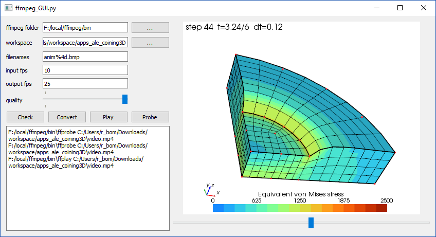

# Minimal GUI for ffmpeg

A basic multi-platform GUI written with PyQt for creating movies from a series of still pictures.
This program uses `ffmpeg`.

## Dependencies
  * [Python 3](https://www.python.org/)
  * [PyQt](https://www.riverbankcomputing.com/software/pyqt/intro), [Qt](https://www.qt.io/)
  * [ffmpeg](https://www.ffmpeg.org/)

## Usage

  * Run `rb-ffmpeg` (pipx) or double-click `rb-ffmpeg.exe` (standalone Windows build).
  * Update the parameters. 
  * Click on [Check] and read the output. A preview should be displayed.
  * Click on [Convert]. The output is named `video.mp4` in the workspace folder.
  * Click on [Play] to see the results (runs `ffplay`)
  * Click on [Probe] to display statistics about `video.mp4` (runs `ffprobe`).



## Notes/TODO
  * check compatibility with PySide
  * make a smarter preview without loading all the images into memory
  * resize preview window
  * download ffmpeg if not found when running from Python (the standalone build already includes it)
  * clear settings

---

## Install from another PC with pipx: (windows)

```
py -m pip install --user pipx
py -m pipx ensurepath
pipx install "git+https://github.com/rboman/progs.git#egg=rb-ffmpeg&subdirectory=apps/ffmpeg"
rb-ffmpeg
```

For a local editable installation, run `pipx install -e ./apps/ffmpeg` from the
repository root. This is a separate package from the root `rboman-progs` tools.
The pipx package still depends only on PyQt5; it uses your own FFmpeg installation.
No PyInstaller dependency or FFmpeg download is added to pipx.

## Standalone Windows executable

From the repository root, on Windows with a 64-bit Python 3.10 or newer:

```powershell
.\apps\ffmpeg\build_exe.ps1
```

If local PowerShell scripts are disabled, use a process-only execution policy:

```powershell
powershell -NoProfile -ExecutionPolicy Bypass -File .\apps\ffmpeg\build_exe.ps1
```

To select another Python interpreter when creating the build environment:

```powershell
.\apps\ffmpeg\build_exe.ps1 -Python C:\Python314\python.exe
```

The script creates `.venv-build`, installs the exact versions in
`requirements-build.txt`, installs this package, downloads the pinned FFmpeg
archive and checks its SHA-256. It checks the three tools and the `libx264` encoder
before running PyInstaller. It does not activate or modify a pipx environment.
Internet access is required for the first build; FFmpeg's verified archive is
cached in `.build/downloads` and checked again on every build. A failed download
never becomes a cache entry. A bad cached checksum stops the build: remove the
named cache file and retry, rather than changing the expected checksum.

The result is **`apps/ffmpeg/dist/rb-ffmpeg.exe`**. This is a portable GUI for
Windows 10/11 x64, including Python, PyQt5/Qt, `ffmpeg`, `ffplay` and `ffprobe`.
Recipients need neither Python nor FFmpeg nor an Internet connection. Copy the
executable to their PC and launch it. No installer or administrator access is
needed. The binary is unsigned.

PyInstaller's `onefile` mode extracts these components to a temporary directory
on each launch, so startup takes longer and requires temporary disk space. The
temporary files are managed by PyInstaller; images and output videos stay in
the folders selected in the GUI. The build environment, download cache and
outputs are ignored by Git.

### Selecting FFmpeg and keeping settings

For each tool, the search order is:

1. The **ffmpeg folder** explicitly entered in the GUI, if that tool runs there.
2. The bundled tools, in a standalone executable.
3. The system `PATH`.

Leave **ffmpeg folder** empty to use the bundled version. For pipx, the second
step is absent. Both versions keep the existing `RoBo/ffmpeg_GUI` Qt settings,
including the last folders and encoding parameters. A previous explicit FFmpeg
folder therefore still takes priority after switching between versions.

### Updating build dependencies

`packaging/ffmpeg.json` records a versioned Gyan Essentials ZIP URL, its SHA-256,
the supplier's checksum URL and the matching FFmpeg source revision. Do not use
a moving `latest` URL. To update it:

1. Select a Windows x64 static Essentials ZIP from
   [Gyan's builds](https://www.gyan.dev/ffmpeg/builds/), also linked from
   [FFmpeg's download page](https://ffmpeg.org/download.html).
2. Verify the supplier's checksum and matching source revision, then update all
   fields in `packaging/ffmpeg.json` together.
3. Update Python pins in `requirements-build.txt` only when needed. The Qt wheel
   version is platform-specific; use a published Windows x64 wheel.
4. Rebuild and run the automated tests and the standalone checklist below.

Keep the same Python version when reproducing a release. `BUILD-INFO.txt`,
embedded in the executable, records Python and the dependency versions. A build
environment created with another Python can be replaced by removing the
project-local `.venv-build` directory and rerunning the script.

### Notices and source access

The **Licenses / Sources** button displays the application's source location and,
in a standalone build, the exact build manifest, upstream FFmpeg documentation
and license, Python license, and license/metadata files supplied by the wheels.
They are embedded in the executable and readable offline.
Select a notice in the list to read it; only the selected file is loaded.
The full FFmpeg HTML manuals open separately in your default browser using
**Open FFmpeg documentation**, rather than being merged into the license reader.

The standalone bundle includes GPL-licensed PyQt5 and FFmpeg components, as well
as Qt and other dependencies with their own notices. Keep matching source,
build configuration, notices and any required source distribution/offer with
each release you redistribute. The manifest identifies the FFmpeg source
revision; upstream documentation identifies its build and external libraries.
An upstream source link alone does not replace the applicable redistribution
requirements. See [FFmpeg's license information](https://ffmpeg.org/legal.html),
[PyQt licensing](https://www.riverbankcomputing.com/software/pyqt/), and the
embedded notices. This build script does not publish or host source archives.

## Tests

After a build, from `apps/ffmpeg`:

```powershell
$env:RB_FFMPEG_TEST_BIN = (Resolve-Path .build\vendor\ffmpeg\bin).Path
.\.venv-build\Scripts\python.exe -m unittest discover -s tests -v
Remove-Item Env:RB_FFMPEG_TEST_BIN
```

The tests run Qt offscreen with isolated settings, without changing your saved
preferences. They cover tool priority, windowless subprocesses, download/cache
errors, checksum rejection, ZIP validation, resource packaging, errors in the
GUI, settings persistence and a real Check/Convert/Probe sequence using the
31 sample images. The integration test includes spaces, accents and an apostrophe
in the working directory; without `RB_FFMPEG_TEST_BIN` it is skipped.

Before sharing a release, test the actual `.exe` on Windows without Python or
FFmpeg in `PATH` (ideally a clean VM):

1. Double-click the executable, leaving **ffmpeg folder** empty.
2. Select `test` as workspace and a writable output folder; click **Check** and
   inspect the image preview and detected tools.
3. Click **Convert**, **Play** (close the playback window), and **Probe**. Confirm
   that only the GUI and video window appear, and that diagnostics reach the log.
4. Repeat with spaces/accents in folder names. Exercise an invalid output path
   and an encoding failure; check that the application reports the error.
5. Open **Licenses / Sources**, close/relaunch the app and verify saved settings.
6. Launch `rb-ffmpeg` through pipx and verify that your external FFmpeg still works.

## Generer le .exe : rappel rapide

Sous Windows, avec Python 3.10+ en 64 bits, depuis la racine du depot :

```powershell
powershell -NoProfile -ExecutionPolicy Bypass -File .\apps\ffmpeg\build_exe.ps1
```

Le script prepare son environnement isole et telecharge FFmpeg automatiquement.
Le fichier a transmettre est `apps/ffmpeg/dist/rb-ffmpeg.exe` ; il contient tout
le necessaire. L'installation personnelle par pipx reste inchangee.

